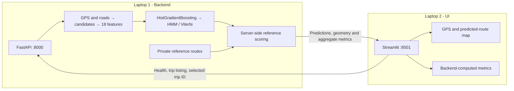

# PathSnap: Distributed Map Matching and Trajectory Reconstruction

PathSnap matches noisy GPS observations to a directed road network using a
HistGradientBoosting candidate classifier and HMM/Viterbi route decoding.
It provides a FastAPI backend on Laptop 1 and a Streamlit evaluator dashboard
on Laptop 2 for the PES University ML hackathon.

Phase 5 is implemented and merged into `main`. Automated tests and physical
two-laptop integration have passed. The frozen system has been scored on the
ten reserved evaluator trips: HMM/Viterbi decoding reaches about 90-91% mean
per-trip accuracy. See [Results](#results) and the team's technical report,
[113.pdf](113.pdf).

## Architecture



Laptop 1 loads the model once, runs inference and computes evaluation metrics.
Laptop 2 makes HTTP requests and renders results; it does not need model weights,
training data or reference labels. The client submits a trip ID, not a track
upload. The corresponding trip files must already exist on Laptop 1.

## Quick start

### Laptop 1: backend

Clone the current repository and install dependencies from its root:

```powershell
git clone https://github.com/shashankv2303/pathsnap.git
cd pathsnap
git switch main
git lfs install
git lfs pull
python -m venv .venv
.\.venv\Scripts\Activate.ps1
python -m pip install -r requirements.txt
```

Use a Python version compatible with the pinned dependencies.
The deployment model records scikit-learn 1.9.0, which is pinned in
`requirements.txt`; local verification used Python 3.14.3.

Start in development mode:

```powershell
$env:PATHSNAP_MODE = "development"
$env:PATHSNAP_TRIP_ROOT = "Student folder\student_test"
python -m uvicorn api.server:app --host 0.0.0.0 --port 8000
```

Check readiness in a second terminal:

```powershell
Invoke-RestMethod http://127.0.0.1:8000/health
Invoke-RestMethod http://127.0.0.1:8000/api/trips
ipconfig
```

API documentation: [http://localhost:8000/docs](http://localhost:8000/docs).
Both laptops need network connectivity; allow inbound TCP 8000 on Laptop 1
for the intended network. Campus Wi-Fi can isolate clients; a shared hotspot
is an alternative. Use one Uvicorn worker for the current single-prediction lock.

### Laptop 2: frontend

In a checkout of this repository on `main`:

```powershell
python -m pip install streamlit requests folium
$env:SERVER_URL = "http://<LAPTOP1_IPV4>:8000"
python -m streamlit run ui/client_app.py
```

Replace `<LAPTOP1_IPV4>` with Laptop 1's current address. Open
[http://localhost:8501](http://localhost:8501), confirm model readiness and mode,
select a dynamically discovered trip, and click **Reconstruct Route**.

The dashboard displays accuracy, continuity, candidate miss rate, normalized
route edit distance (lower is better), processing time and expandable diagnostics.
Missing metrics display `Unavailable`; genuine zeros remain zero.
The map shows blue GPS observations and red predicted route segments with layer
toggles. Map tiles require internet access.

Prediction timeout defaults to 300 seconds and can be increased in the sidebar.
Busy responses (503) receive two retries, 1.5 seconds apart. Network failures,
timeouts, unavailable trips (404) and rejected requests (422) display readable
errors. After a timeout, check Laptop 1 logs before resubmitting.

### Official evaluator mode

Changing the mode does not turn student-test data into official evaluator data.
Obtain the reserved dataset from the organizers and keep it privately on Laptop 1:

```text
C:\PathSnapPrivate\evaluator\
  00000015\
    00000015.track
    00000015.nodes
    00000015.arcs
    00000015.route
  ...
```

Stop the backend with Ctrl+C, then restart from the repository root:

```powershell
$env:PATHSNAP_MODE = "evaluator"
$env:PATHSNAP_TRIP_ROOT = "C:\PathSnapPrivate\evaluator"
python -m uvicorn api.server:app --host 0.0.0.0 --port 8000
```

Use the actual dataset path. Evaluator mode requires an explicit directory,
rejects student development paths, and requires server-side reference routes
for discovered valid trips. Refresh Laptop 2 and confirm `Mode: evaluator`.
Do not copy private evaluator routes to Laptop 2 or commit them to Git.

See [the deployment guide](docs/PHASE5_DEPLOYMENT.md) for network setup,
configuration options and troubleshooting.

## API and configuration

| Endpoint | Purpose |
|---|---|
| `GET /health` | Readiness, model status, mode and discovered trip count |
| `GET /api/trips` | Available trip IDs, including compatibility aliases |
| `POST /api/predict_trip` | Predict and score one server-side trip |

Example prediction request:

```json
{"trip_id": "00000000", "use_hmm": true, "generate_map": true}
```

Responses contain observation assignments, aggregate metrics and optional GPS /
predicted-route geometry. Coordinates use `[longitude, latitude]`; the UI
converts them to Folium's `[latitude, longitude]`. Reference routes and alignments
are excluded. Requests accept eight-digit trip IDs; unknown IDs return 404,
invalid payloads 422, and overlapping predictions 503.

| Environment variable | Default / purpose |
|---|---|
| `PATHSNAP_MODE` | `development` or `evaluator` |
| `PATHSNAP_TRIP_ROOT` | `Student folder/student_test` in development; explicit private path in evaluator mode |
| `PATHSNAP_MODEL_PATH` | `pathsnap/artifacts/deployment_model/model.joblib` |
| `PATHSNAP_CONFIG_PATH` | `model_config.json` alongside the chosen model |
| `PATHSNAP_DECODER_CONFIG` | `results/hmm-viterbi/decoder_config.json` |
| `SERVER_URL` | Laptop 2 backend URL; defaults to `http://127.0.0.1:8000` |

Legacy `PATHSNAP_MODEL` is accepted if `PATHSNAP_MODEL_PATH` is unset.

## Data and inference pipeline

There are 80 training trips and 10 student-test trips in `Student folder/`.
The reserved evaluator partition is separate and is not included as development
data.

| File | Format used by the loaders |
|---|---|
| `.track` | Whitespace-separated longitude, latitude, timestamp |
| `.nodes` | Longitude and latitude; node ID is the zero-based row index |
| `.arcs` | From-node and to-node IDs; arc ID is the zero-based row index |
| `.route` | Ordered reference arc IDs, read separately for training labels or scoring |

The current projector uses a local equirectangular metric approximation centered
at the trajectory origin. GPS preprocessing derives headings, speeds,
accelerations and gap diagnostics while retaining observations.

Candidate generation samples directed arcs at approximately 25 m intervals,
indexes samples in SciPy `cKDTree`, and uses a 35 m query radius. If no samples
are found, it queries up to 15 nearest samples, deduplicates arc IDs and computes
exact point-to-segment distances. Fifteen is a fallback sample count, not a
global cap on the number of candidate arcs.

The classifier receives these ordered features:

| Group | Features |
|---|---|
| Spatial | `dist_perp`, `arc_length`, `proj_ratio`, `gps_displacement`, `dist_margin` |
| Directional | `road_bearing`, `gps_bearing`, `angular_diff`, `heading_cos` |
| Kinematic | `dt_sec`, `speed_mps`, `accel_mps2` |
| Topological | `is_connected_prev`, `net_to_euc_ratio`, `target_out_degree` |
| Ranking | `spatial_likelihood`, `cand_rank`, `cand_rel_dist` |

The decoder combines log classifier scores with directed-network transition
penalties and backtracking. It includes connecting arcs and preserves explicit
route breaks across implausible transitions or large time gaps. The saved
configuration uses a 10 m transition scale and a 10-second maximum gap.
Inference uses GPS and road inputs; reference routes are loaded separately
after prediction for scoring.

## Models and result provenance

The deployed classifier is `pathsnap/artifacts/deployment_model/model.joblib`.
Its configuration records 80 training trips and 1,208,139 candidate rows.
It uses 160 iterations, 29 leaves, learning rate 0.041953, minimum leaf size 30,
L2 regularization 0.338523 and balanced class weights.

This separate deployment artifact was rebuilt for compatibility after the
original exported model failed to load in the installed environment. Original
artifacts remain available. It is distinct from the full-search tuned model:

| Location | Role |
|---|---|
| `pathsnap/artifacts/deployment_model/` | Default model served by Phase 5 |
| `pathsnap/artifacts/final_model/` | Original export, subset-search parameters and historical schema |
| `results/bayesian-full/` | Eight-trial, five-fold, full-training search and its baseline/tuned artifacts |
| `results/hmm-viterbi/` | Historical tuned-model route comparison and decoder configuration |

The historical five-family benchmark covers Logistic Regression, Random Forest,
Extra Trees, HistGradientBoosting and MLP. The full-training Optuna search
selected its tuned classifier using trip-grouped cross-validation.
See [the model documentation](pathsnap/models/README.md) and
[the recorded Phase 3/4 results](results/phase3-phase4-summary.md).

Dashboard results are live, per-selected-trip metrics computed by the backend.
Development mode reports student-test results by default. Pointwise accuracy
uses reliable reference-aligned observations; continuity uses eligible
transitions. Candidate miss rate and route edit distance have different
denominators and meanings; do not interpret them as accuracy.

## Results

Accuracy counts GPS points that could be aligned to the reference route within
50 m. **Mean per trip** gives each trip equal weight; **pooled** gives each
scorable GPS point equal weight. Evaluator trips were scored only after the
model and decoder settings were frozen, and those scores were not used to change
anything.

### Recorded results (team report)

From the full-search tuned classifier with HMM/Viterbi decoding, as reported in
[113.pdf](113.pdf) and [the model documentation](pathsnap/models/README.md):

| Split | Trips | Scorable points | Mean per trip | Pooled |
|---|---:|---:|---:|---:|
| Training | 80 | 178,963 | 87.68% | 87.82% |
| Validation, five held-out folds | 80 | 178,963 | 87.18% | 86.88% |
| Student test | 10 | 19,131 | 89.95% | 87.83% |
| Evaluator test | 10 | 17,708 | **90.11%** | **84.83%** |

On student test, Viterbi raised mean per-trip accuracy from 83.88% (classifier
only) to 89.95%, continuity from 91.40% to 99.81%, and lowered normalised route
edit distance from 0.529 to 0.181.

### Re-run on current `main` (20 November 2026)

Both saved models were re-scored with
`pathsnap.decoding.evaluate_partition` on macOS. The deployment model is the one
the API serves by default.

| Model | Split | Classifier only, mean | With Viterbi, mean | With Viterbi, pooled | Continuity | Route edit distance |
|---|---|---:|---:|---:|---:|---:|
| Tuned (`results/bayesian-full/`) | Student test | 83.98% | 90.27% | 87.96% | 99.81% | 0.182 |
| Tuned (`results/bayesian-full/`) | Evaluator test | 82.92% | 90.81% | 85.97% | 99.86% | 0.211 |
| Deployment (served by API) | Student test | 83.87% | 90.28% | 88.16% | 99.81% | 0.168 |
| Deployment (served by API) | Evaluator test | 83.00% | **91.10%** | **86.52%** | 99.86% | 0.200 |

Evaluator test by trip, with Viterbi:

| Trip | GPS points | Scorable | Tuned model | Deployment model |
|---|---:|---:|---:|---:|
| `00000015` | 6,854 | 6,833 | 73.15% | 74.33% |
| `00000017` | 1,346 | 1,346 | 94.06% | 94.58% |
| `00000023` | 458 | 458 | 94.98% | 94.98% |
| `00000030` | 654 | 654 | 85.78% | 86.70% |
| `00000049` | 2,642 | 2,642 | 99.74% | 99.74% |
| `00000059` | 1,031 | 1,031 | 97.58% | 97.48% |
| `00000067` | 916 | 916 | 85.04% | 85.26% |
| `00000073` | 1,144 | 1,144 | 98.51% | 98.25% |
| `00000087` | 1,399 | 1,399 | 99.43% | 99.43% |
| `00000094` | 3,230 | 1,285 | 79.84% | 80.23% |

Trip `00000015` is the largest and weakest, which is why pooled accuracy is lower
than the mean per trip. Trip `00000094` has only 1,285 of 3,230 points within 50 m
of its reference route.

The re-run uses the same code, models, decoder settings and scorable points as
the recorded run, but its tuned-model figures are slightly higher (for example
90.27% vs 89.95% on student test). The classifier makes a few different choices
between near-equal candidates on this machine (for example 1 of 768 points on
trip `00000065`), and Viterbi can carry such a change along the route; that trip
moved from 79.95% to 83.07%. Results are identical between repeated runs on the
same machine. The recorded figures are those in the report; the re-run files
are in `results/evaluator-test/` and `results/student-test/`.

## Repository layout

```text
api/                      FastAPI server, inference service, deployment rebuild script
ui/                       Streamlit HTTP client
pathsnap/
  preprocessing/          GPS and road-network loaders
  geospatial/             Projection and geometry
  candidate_generation/   Sampled-arc spatial index
  feature_engineering/    Ordered 18-feature extractor
  dataset/                Candidate dataset construction
  models/                 Classifier implementations and model documentation
  experiments/            Benchmarks and Optuna searches
  decoding/               Viterbi inference and evaluation
  evaluation/             Model evaluation helpers
  visualization/          Historical EDA maps and generation tools
  artifacts/              Model exports and EDA maps
  data/                   Git LFS candidate caches
  reports/                Experiment reports and historical audits
  tests/                  Unit, API, integration and UI tests
Student folder/           Permitted training and student-test trip files
results/                  Tuning, route decoding, and evaluator/student-test scoring
113.pdf                   Team technical report
docs/                     Supplied PDFs/video and current deployment guide
pathsnap_analysis/        Design and problem-analysis documents
reference_analysis/       Course-reference analysis
```

Unused root scaffold folders were removed. Historical reports and audits record
the state at their own dates; use this README and the deployment guide for
current entry points.

## Verification status

Last verified on 18 November 2026:

- `python -m pytest pathsnap/tests -v`: **46 passed, 0 failed, 0 skipped**,
  with one upstream TestClient deprecation warning.
- Real local Streamlit-to-Uvicorn HTTP checks passed for two development trips.
- Physical Laptop 2-to-Laptop 1 checks passed for health, dynamic trips and
  predictions for `00000000` and `00000007`.
- Chromium rendered live GPS/route maps and map tiles; Laptop 1 logs supplied
  by the user confirmed the client requests, timings and HMM execution.
- 20 November 2026: the 46 tests passed again, and both saved models were
  scored on all ten evaluator trips (see [Results](#results)).

These are recorded verification results, not a guarantee of current LAN
reachability. Restart both services and check health after changing networks.

## Reproducing experiments

Serving the application does not require retraining. From the repository root:

```powershell
python -m pathsnap.dataset.build_full_datasets
python -m pathsnap.experiments.cross_validation
```

For a new full-search run, choose an unused output directory:

```powershell
git lfs pull --include="pathsnap/data/train_candidates.joblib,pathsnap/data/student_test_candidates.joblib"
python -m pathsnap.experiments.full_bayesian_optimization --trials 8 --out results/bayesian-new
python -m pathsnap.decoding.evaluate --model results/bayesian-new/tuned_model.joblib --out results/hmm-new
```

To score a frozen model and decoder on a trip folder that includes reference
routes (for example the private evaluator trips on Laptop 1):

```powershell
python -m pathsnap.decoding.evaluate_partition --trip-root C:\PathSnapPrivate\evaluator --model pathsnap/artifacts/deployment_model/model.joblib --out results/evaluator-new
```

It predicts each trip before reading its reference route and writes
`per_trip.csv`, `summary.csv` and predictions. It refuses to overwrite an
existing output folder.

The original saved runs remain under `results/bayesian-full/` and
`results/hmm-viterbi/`. The deployment rebuild entry point is
`python -m api.train_deployment_model`; it trains only on the 80 training trips
and refuses to overwrite an existing deployment output directory.
Do not rebuild merely to launch the application.
