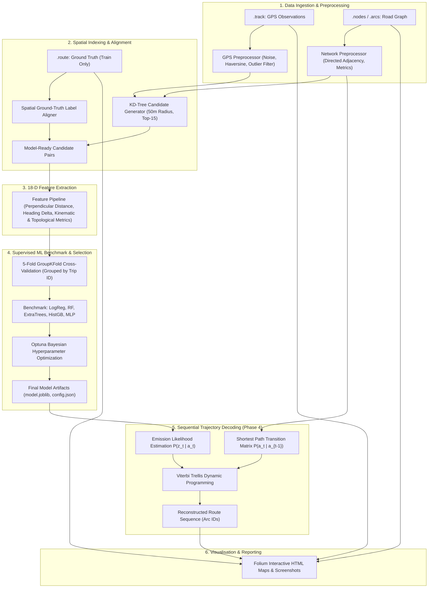
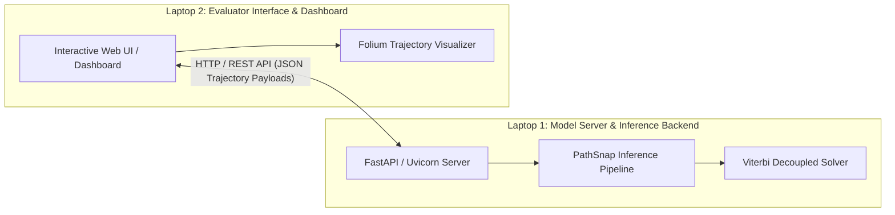

# PathSnap: Distributed Map-Matching & Trajectory Reconstruction

**PathSnap** is a high-performance, fault-tolerant geospatial machine learning pipeline designed to solve the GPS-to-road-network map-matching problem. Developed for the PES University Machine Learning Hackathon (Course Code: UE24CS352A), PathSnap reconstructs the true sequence of road network segments traversed by a vehicle from noisy, multipath-corrupted, and irregularly sampled GPS observations.

---

## Table of Contents

1. [Project Overview](#1-project-overview)
2. [Problem Statement & Mathematical Formulation](#2-problem-statement--mathematical-formulation)
3. [System Architecture](#3-system-architecture)
4. [Dataset File Descriptions](#4-dataset-file-descriptions)
5. [Data Preprocessing Pipeline](#5-data-preprocessing-pipeline)
6. [Spatial Candidate-Generation Methodology](#6-spatial-candidate-generation-methodology)
7. [18-Dimensional Feature Engineering](#7-18-dimensional-feature-engineering)
8. [Machine Learning Model Experimentation](#8-machine-learning-model-experimentation)
9. [Model Selection & Bayesian Optimisation](#9-model-selection--bayesian-optimisation)
10. [HMM & Viterbi Decoding Integration Status](#10-hmm--viterbi-decoding-integration-status)
11. [Geographical Folium Visualisation](#11-geographical-folium-visualisation)
12. [Installation & Setup](#12-installation--setup)
13. [Execution Guide](#13-execution-guide)
14. [Testing & Quality Assurance](#14-testing--quality-assurance)
15. [Deployment Architecture](#15-deployment-architecture)
16. [Current Implementation Status](#16-current-implementation-status)

---

## 1. Project Overview

Raw GPS trajectories collected from moving vehicles suffer from urban multipath reflection, signal dropouts, sensor drift, and parallel-corridor ambiguities. PathSnap formulates map matching as a sequential probabilistic inference task:
1. **Candidate Retrieval**: A 2D spatial KD-Tree identifies geometrically plausible road segments within a calibrated radius $r = 50\text{ m}$.
2. **Supervised Scoring (Emission Model)**: An ensemble gradient-boosted decision tree evaluates an 18-dimensional geospatial feature vector for each candidate road segment to estimate $P(z_t \mid c_t^i)$.
3. **Sequential Trajectory Decoding (Transition Model)**: A Hidden Markov Model (HMM) evaluates topological road connectivity and transitions using shortest network path metrics, decoded globally via the dynamic programming Viterbi algorithm.

---

## 2. Problem Statement & Mathematical Formulation

Given a sequence of $T$ time-ordered GPS observations:
$$\mathcal{Z} = (z_1, z_2, \dots, z_T), \quad z_t = (\text{lat}_t, \text{lon}_t, t_t, v_t, \theta_t)$$
and a directed road network graph $G = (V, E)$, find the optimal sequence of traversed road arcs:
$$\mathcal{A}^* = (a_1^*, a_2^*, \dots, a_T^*), \quad a_t^* \in E$$
that maximizes the joint posterior probability:
$$\mathcal{A}^* = \arg\max_{\mathcal{A}} \left[ \prod_{t=1}^T P(z_t \mid a_t) \cdot \prod_{t=2}^T P(a_t \mid a_{t-1}) \right]$$

- **Emission Likelihood** $P(z_t \mid a_t)$: Modeled via calibrated class probabilities output by a trained machine learning classifier over 18 geometric, kinematic, and topological features.
- **Transition Probability** $P(a_t \mid a_{t-1})$: Modeled via exponential decay of path discrepancy:
  $$P(a_t \mid a_{t-1}) = \frac{1}{\beta} \exp\left(-\frac{|d_{\text{network}}(a_{t-1}, a_t) - d_{\text{euclidean}}(z_{t-1}, z_t)|}{\beta}\right)$$

---

## 3. System Architecture



---

## 4. Dataset File Descriptions

| Extension | Component | Key Attributes / Content |
| :--- | :--- | :--- |
| `.track` | Raw GPS Trajectory | Time-ordered observations: `[latitude, longitude, timestamp, speed, heading]` |
| `.nodes` | Road Network Vertices | Unique node ID and geographic coordinates: `[node_id, longitude, latitude]` |
| `.arcs` | Road Network Edges | Directed arcs connecting nodes: `[arc_id, from_node, to_node, length, speed_limit]` |
| `.route` | Ground-Truth Reference | Ground-truth sequence of traversed `arc_id` values (permitted training/dev trips only) |

> **Evaluation Data Isolation**: Evaluator ground-truth routes are strictly isolated. No evaluator data or labels are used in training, validation, or feature extraction.

---

## 5. Data Preprocessing Pipeline

Implemented in `pathsnap/preprocessing/`:
- **Coordinate Conversion**: Equirectangular projection centered at trajectory local origin for Cartesian spatial distance computation:
  $$x = R \cdot (\lambda - \lambda_0) \cos(\phi_0), \quad y = R \cdot (\phi - \phi_0)$$
- **Kinematic Filtering**: Detection of unrealistic GPS acceleration ($> 8\text{ m/s}^2$) and excessive speeds ($> 45\text{ m/s}$).
- **Temporal Gap Imputation**: Identification of sensor dropouts ($\Delta t > 10\text{ s}$) to prevent invalid transition probability assumptions.
- **Network Graph Construction**: Directed network adjacency list with bidirectional arc handling, node-to-arc indexing, and precomputed arc Euclidean lengths.

---

## 6. Spatial Candidate-Generation Methodology

Implemented in `pathsnap/candidate_generation/`:
- Precomputed arc midpoints indexed into `scipy.spatial.KDTree`.
- Configured search radius: $r = 50.0\text{ m}$ (with adaptive fallback up to $100\text{ m}$).
- Maximum candidates per observation: $K = 15$.
- **Performance Across Full Dataset**:
  - Training Set (80 trips): $1,208,139$ total candidates; **$99.465\%$ recall cap** (only $0.535\%$ miss rate).
  - Student-Test Set (10 trips): $137,520$ total candidates; **$99.906\%$ recall cap** (only $0.094\%$ miss rate).

---

## 7. 18-Dimensional Feature Engineering

Implemented in `pathsnap/feature_engineering/`:

| # | Feature Name | Description | Intuition / Importance |
| :---: | :--- | :--- | :--- |
| 1 | `distance_to_arc` | Orthogonal Euclidean distance from GPS point to arc | Primary spatial proximity indicator |
| 2 | `along_arc_fraction` | Projection scalar $t \in [0, 1]$ along arc vector | Measures whether GPS point falls within segment bounds |
| 3 | `heading_delta` | Minimal angular difference $|\theta_{\text{GPS}} - \theta_{\text{arc}}|$ | Penalizes opposing-direction or perpendicular roads |
| 4 | `speed_limit_delta` | Difference between GPS speed and posted arc limit | Identifies highway vs residential mismatch |
| 5 | `distance_rank` | Rank of arc among candidate pool sorted by distance | Relative spatial closeness |
| 6 | `heading_rank` | Rank of arc among candidate pool sorted by heading | Relative orientation alignment |
| 7 | `speed_to_limit_ratio` | Ratio $v_{\text{GPS}} / v_{\text{limit}}$ | Velocity consistency check |
| 8 | `spatial_gap_flag` | Binary indicator for large spatial jumps ($> 50\text{ m}$) | Flags multipath reflections |
| 9 | `temporal_gap_flag` | Binary indicator for sampling dropouts ($\Delta t > 10\text{ s}$) | Flags sensor blackout intervals |
| 10 | `is_one_way` | Graph edge directionality flag | Prevents wrong-way traversal matching |
| 11 | `arc_length` | Total geographic length of the candidate arc | Prioritizes continuous arterial corridors |
| 12 | `candidate_count` | Total candidates retrieved for observation | Ambiguity context (dense urban vs highway) |
| 13 | `delta_d_vs_delta_s` | Difference between Euclidean step and arc projection | Trajectory consistency check |
| 14 | `endpoint_proximity` | Distance to nearest node $u$ or $v$ of the arc | Identifies turn and intersection maneuvers |
| 15 | `projection_out_of_bounds` | Distance GPS projection extends beyond arc vertices | Detects overshoot / geometric clipping |
| 16 | `gps_speed` | Raw observed GPS instantaneous speed | Kinematic state input |
| 17 | `gps_heading` | Raw observed GPS bearing | Directional state input |
| 18 | `normalized_distance` | Distance divided by candidate search radius ($d / r$) | Scale-invariant proximity metric |

---

## 8. Machine Learning Model Experimentation

Five distinct model families were implemented, trained using 5-fold `GroupKFold` cross-validation (strictly grouped by `trip_id` across 80 trips, $1.2\text{M}$ instances), and evaluated on the held-out student-testing set (10 trips, $137.5\text{K}$ instances):

| Model Family | Algorithm Implementation | CV Macro-F1 | Test Top-1 Accuracy | Test Recall | Training Time |
| :--- | :--- | :---: | :---: | :---: | :---: |
| **Linear** | Scikit-learn `LogisticRegression` (L2 penalty) | $0.7889$ | $80.75\%$ | $92.75\%$ | $18.4\text{ s}$ |
| **Ensemble (Bagging)** | Scikit-learn `RandomForestClassifier` (100 trees) | $0.8587$ | $82.68\%$ | $92.68\%$ | $335.8\text{ s}$ |
| **Ensemble (Extreme)** | Scikit-learn `ExtraTreesClassifier` (100 trees) | $0.8496$ | $81.95\%$ | $93.28\%$ | $248.2\text{ s}$ |
| **Ensemble (Boosting)** | Scikit-learn `HistGradientBoostingClassifier` | $\mathbf{0.8441}$ | $\mathbf{81.98\%}$ | $\mathbf{94.26\%}$ | $\mathbf{22.5\text{ s}}$ |
| **Neural Network** | Scikit-learn `MLPClassifier` (2 layers: 64, 32) | $0.8497$ | $82.33\%$ | $79.60\%$ | $291.3\text{ s}$ |

---

## 9. Model Selection & Bayesian Optimisation

### Winning Model: `HistGradientBoostingClassifier`
- **Highest True-Positive Recall ($94.26\%$)**: Minimizes false negatives in candidate emission likelihoods, which is critical for preventing the downstream Viterbi decoder from pruning the ground-truth path.
- **Superior Training & Inference Speed**: Trains in $22.5\text{ s}$ ($15\times$ faster than Random Forest) with native binned histogram operations.
- **Calibrated Probabilities**: Produces smooth probability distributions suitable for direct conversion to HMM emission log-likelihoods.

### Bayesian Hyperparameter Optimisation (Optuna)
The original subset experiment executed 30 objective trials using 3-fold
GroupKFold. Its recorded parameters were:
- `learning_rate`: `0.04195`
- `max_iter`: `160`
- `max_leaf_nodes`: `29`
- `min_samples_leaf`: `30`
- `l2_regularization`: `0.3385`
- `class_weight`: `'balanced'`

Saved artifacts are exported in `pathsnap/artifacts/final_model/`:
- `model.joblib`: Serialized trained model weights
- `model_config.json`: Model metadata, framework version, and input contract
- `feature_schema.json`: Complete 18-feature specification with descriptions and ranges
- `best_hyperparameters.json`: Optuna optimal parameters

The subsequent full-training search evaluated eight Optuna trials using five
grouped folds across all 80 training trips. Its tuned model and comparison
are in `results/bayesian-full/`, and the measured phase summary is in
[`results/phase3-phase4-summary.md`](results/phase3-phase4-summary.md).

---

## 10. HMM & Viterbi Decoding Integration Status

- **Status**: Implemented and evaluated on all ten student-test trips. The
  implementation and measured comparison are described in the execution guide.
- **Mathematical Design**:
  - State space: Set of candidate arcs $\mathcal{C}_t = \{c_t^1, \dots, c_t^K\}$ for each observation $t$.
  - Emission probability: $P(z_t \mid c_t^i) = P_{\text{ML}}(\text{label}=1 \mid \mathbf{x}_t^i)$.
  - Transition probability: Log-distance discrepancy penalty based on shortest network path between arc endpoints:
    $$V_t(j) = \max_{i} \left[ V_{t-1}(i) + \ln P(c_t^j \mid c_{t-1}^i) \right] + \ln P(z_t \mid c_t^j)$$
- **Extensible Hook**: The visualisation engine and model scoring pipelines are pre-configured to receive predicted arc arrays via `predicted_route_arcs`.

---

## 11. Geographical Folium Visualisation

Implemented in `pathsnap/visualization/map_visualizer.py`:
- **Interactive Layer Controls**: Toggle GPS points, road network geometry, candidate vectors, ground-truth routes, and predicted paths.
- **Spatial Bounding-Box Buffer**: Dynamically slices the $165,000$-arc network graph to the trajectory vicinity ($\pm 0.005^\circ$), ensuring fast rendering.
- **Automated High-Resolution Screenshots**: Generates $1440 \times 900$ PNG captures via headless Chromium for reporting.

Generated visual maps:
- `trip_00000001_map.html`: Urban intersection network with dense parallel candidate corridors.
- `trip_00000000_map.html`: High-speed arterial corridor with sparse sampling and heading variations.

---

## 12. Installation & Setup

### Prerequisites
- Python 3.9+ (Windows, Linux, or macOS)
- Git and Git LFS

### Setup Instructions

```bash
# Clone the repository
git clone https://github.com/shashankv2303/pathsnap.git
cd pathsnap

# Initialize Git LFS
git lfs install
git lfs pull

# Create and activate virtual environment
python -m venv venv
# Windows:
.\venv\Scripts\activate
# Linux/macOS:
source venv/bin/activate

# Install dependencies
pip install -r requirements.txt
```

---

## 13. Execution Guide

### 1. Build Preprocessed Datasets
```bash
python -m pathsnap.dataset.build_full_datasets
```

### 2. Run 5-Model Benchmark
```bash
python -m pathsnap.experiments.benchmark_runner
```

### 3. Run Bayesian Hyperparameter Optimisation
```bash
git lfs pull --include="pathsnap/data/train_candidates.joblib,pathsnap/data/student_test_candidates.joblib"
python -m pathsnap.experiments.full_bayesian_optimization --trials 8 --out results/bayesian-full
```

Use a new output directory for each run. This run evaluates every trial on five
trip-grouped folds across all 80 training trips. Optuna's seeded TPE sampler
starts with the benchmark baseline and the previous subset winner, then searches
learning rate, iteration count, leaf count, minimum leaf size, L2 regularization,
and class weighting. Internal row-based early stopping is disabled throughout.
The objective is mean candidate-level Macro F1, matching the earlier search.

After selection, both configurations are refitted on all 80 trips and evaluated
on the aligned candidates from all 10 student-test trips. The output directory contains the fold assignment,
per-trial and per-fold results, tuned-versus-baseline metrics, runtime and model
metadata, and both reload-verified models. Observation-level Macro F1 is reported
for observations with a retrieved reference arc, since the candidate cache does
not retain the missing reference arc ID. Top-1 includes misses among aligned
observations represented in the cache.
Use the same command with `--finish-existing` to refit and evaluate from a complete
search if the export was interrupted.

### 4. Locate the exported model

The full-training search exports `tuned_model.joblib` and `model_config.json`
to its output directory. The original subset export command reads the original
configuration under `pathsnap/artifacts/final_model/`.

### 5. Generate Folium Interactive Maps & Screenshots
```bash
python -m pathsnap.visualization.generate_eda_maps
```

### 6. Run the HMM/Viterbi comparison

```bash
python -m pathsnap.decoding.evaluate --model results/bayesian-full/tuned_model.joblib --out results/hmm-viterbi
```

The decoder uses one directed candidate arc per observation as its hidden state.
It maximizes the sum of log classifier scores and transition scores. Transitions
penalize the difference between GPS displacement and the shortest directed
distance between projected candidate positions. Implausible distances, missing
candidates, and timestamp gaps produce explicit route breaks. Directed connecting
arcs are included in the reconstructed route segments.

The comparison selects the transition scale on four training trips, then runs
classifier argmax and classifier-plus-Viterbi on identical candidates from all
ten student-test trips. It reports pointwise accuracy on aligned observations,
continuity on eligible consecutive assignments, normalized route edit distance
(lower is better), and timing. The phase exports a decoder configuration,
per-trip results, and predicted assignments and route segments. For serving,
`pathsnap.decoding.pipeline.predict_trip` uses the track and road-network files.
The evaluation command loads reference routes separately after prediction.

---

## 14. Testing & Quality Assurance

PathSnap includes automated test suites covering coordinate transformations, candidate generation, feature engineering, and preprocessing:

```bash
# Run complete test suite
pytest pathsnap/tests -v
```

---

## 15. Deployment Architecture



- **Distributed Strategy**: Laptop 1 hosts the compute-intensive feature extractor and HMM decoder behind a high-throughput REST API. Laptop 2 acts as the evaluator client, sending raw `.track` files and rendering interactive Leaflet/Folium comparison maps.

---

## 16. Current Implementation Status

| Milestone / Component | Status | Verification & Evidence |
| :--- | :---: | :--- |
| **Phase 1: Problem Exploration & Analysis** | **COMPLETED** | Inventory, literature analysis, and mathematical architecture reports |
| **Phase 2: Preprocessing & 18-D Features** | **COMPLETED** | Equirectangular projection, KD-tree generator ($99.5\%$ recall), 18-D pipeline |
| **Phase 3: Full 5-Model Benchmark** | **COMPLETED** | 5-Fold GroupKFold CV across 80 trips; LogReg, RF, ExtraTrees, HistGB, MLP |
| **Phase 3: Optuna Bayesian Optimisation** | **COMPLETED** | Eight full-training, five-fold trials targeting candidate Macro F1 |
| **Phase 3: Production Model Export** | **COMPLETED** | Serialized `model.joblib`, schema, and hyperparameters in `artifacts/final_model/` |
| **Geographical Visualisation (Folium)** | **COMPLETED** | Multi-layer interactive maps and PNG screenshots for trips `00000000` and `00000001` |
| **Phase 4: HMM & Viterbi Decoder** | **COMPLETED** | Classifier-only versus decoded comparison on all ten student-test trips |
| **Phase 5: Distributed API & UI (Laptop 1/2)** | **IMPLEMENTED** | FastAPI server, Streamlit evaluator client, deployment artifact and integration tests; physical two-laptop LAN verification remains |

See [Phase 5 deployment instructions](docs/PHASE5_DEPLOYMENT.md) for commands,
environment settings, and the deployment-model compatibility repair.
