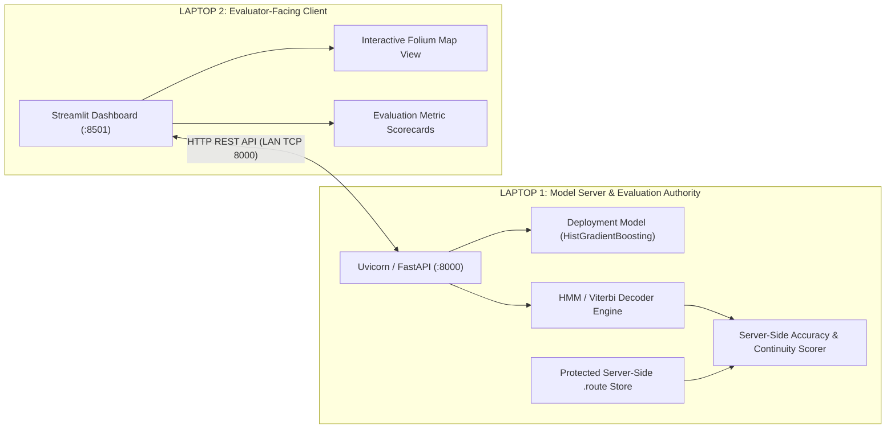

# PathSnap Phase 5: Distributed Deployment Guide

## 1. System Architecture & Topology

PathSnap deploys in a two-tier distributed setup across two physical laptops:



- **Laptop 1 (Model Server & Evaluation Authority)**:
  - Binds to `0.0.0.0:8000` on the local private network.
  - Loads serialized deployment model and Phase 4 HMM/Viterbi decoder configuration once at startup.
  - Houses the confidential evaluator ground truth (`.route`) files server-side.
  - Computes all evaluation metrics internally and displays live structured console logs.
- **Laptop 2 (Evaluator Client Interface)**:
  - Runs Streamlit UI (`ui/client_app.py`).
  - Calls `GET /health`, `GET /api/trips`, and `POST /api/predict_trip`.
  - Displays interactive Leaflet/Folium maps (raw GPS points and predicted route polylines) and metric scorecards.
  - **Zero ground truth access**: Never receives `.route` files, ground-truth geometry, or training labels.

---

## 2. Laptop 1 Configuration & Execution

### Prerequisites
- Python 3.9+ with `requirements.txt` installed.
- Windows 11 / Linux with private network connectivity.

### Environment Modes (`PATHSNAP_MODE`) & Variables

| Variable | Default Value | Production Evaluator Value | Purpose |
| :--- | :--- | :--- | :--- |
| `PATHSNAP_MODE` | `development` | `evaluator` | `evaluator` strictly requires reserved evaluation trips and fails fast if `.route` is missing. |
| `PATHSNAP_TRIP_ROOT` | `Student folder/student_test` | `C:\path\to\official_evaluator_folder` | Path to trip directories. In evaluator mode, never points to student data. |
| `PATHSNAP_MODEL_PATH` | `pathsnap/artifacts/deployment_model/model.joblib` | *(keep default)* | Path to saved HistGradientBoostingClassifier. (Legacy `PATHSNAP_MODEL` also accepted). |
| `PATHSNAP_CONFIG_PATH` | `pathsnap/artifacts/deployment_model/model_config.json` | *(keep default)* | Path to 18-feature schema configuration. |
| `PATHSNAP_DECODER_CONFIG`| `results/hmm-viterbi/decoder_config.json` | *(keep default)* | Path to Viterbi decoder configuration. |

### Step-by-Step Laptop 1 Deployment

1. **Install Dependencies**:
   ```bash
   python -m pip install -r requirements.txt
   ```

2. **Discover Laptop 1 Private IPv4 Address**:
   - In PowerShell:
     ```powershell
     (Get-NetIPAddress -AddressFamily IPv4 | Where-Object { $_.InterfaceAlias -notlike "*Loopback*" -and $_.IPAddress -notlike "169.254*" }).IPAddress
     ```
   - Example output: `192.168.1.105`

3. **Configure Windows Firewall for Port 8000** (Private Network):
   - Run in Administrator PowerShell:
     ```powershell
     New-NetFirewallRule -DisplayName "PathSnap Laptop 1 Model Server" -Direction Inbound -LocalPort 8000 -Protocol TCP -Action Allow -Profile Private
     ```

4. **Launch Model Server**:
   - **For Development Mode**:
     ```powershell
     $env:PATHSNAP_MODE = "development"
     $env:PATHSNAP_TRIP_ROOT = "Student folder\student_test"
     python -m uvicorn api.server:app --host 0.0.0.0 --port 8000
     ```
   - **For Evaluator Demonstration Mode**:
     ```powershell
     $env:PATHSNAP_MODE = "evaluator"
     $env:PATHSNAP_TRIP_ROOT = "C:\path\to\official_evaluator_folder"
     python -m uvicorn api.server:app --host 0.0.0.0 --port 8000
     ```

5. **Verify Local Readiness**:
   - Health check: `curl http://127.0.0.1:8000/health`
   - Interactive OpenAPI documentation: open `http://127.0.0.1:8000/docs` in a browser.

---

## 3. Laptop 2 Configuration & Execution

1. **Install Client Dependencies**:
   ```bash
   pip install streamlit requests folium
   ```

2. **Configure Server URL**:
   - Point `$env:SERVER_URL` to Laptop 1's private LAN IP:
     ```powershell
     $env:SERVER_URL="http://192.168.1.105:8000"
     ```

3. **Launch Streamlit Client**:
   ```powershell
   python -m streamlit run ui/client_app.py
   ```
   Open `http://localhost:8501` in a browser.

The client displays live health, model readiness, mode and trip count before
enabling reconstruction. It accepts `evaluation_trips` or `trips`, and
`predicted_route` or `matched_sequence`. Missing metrics display `Unavailable`;
zero values remain zero. Route edit distance is lower-is-better. Additional
backend metrics are in Execution diagnostics.

The sidebar prediction timeout defaults to 300 seconds and can be increased;
connection timeout is 5 seconds. Health and trip discovery use a 10-second
read timeout. A prediction receiving HTTP 503 is retried twice with 1.5-second
pauses, then reports that the backend is busy. A timeout is never automatically
retried because the original prediction may still be running. For 404, refresh
the page to rediscover trips; 422 indicates rejected request settings.

Map coordinates arrive as `[longitude, latitude]` and are converted on the
client to Folium's `[latitude, longitude]`. Blue GPS markers and red predicted
route segments have independent layer toggles. Route breaks remain separate;
empty geometry is handled without drawing a map. No reference geometry is
loaded or displayed. Laptop 2 needs only the UI script and client dependencies.

If Laptop 1 is unreachable, verify its local `/health`, Uvicorn's `0.0.0.0`
binding, and inbound TCP 8000 on its active Windows network profile. Campus
Wi-Fi may isolate clients; use a shared hotspot if necessary. Do not change
firewall settings on Laptop 2 to work around an unreachable backend.

---

## 4. API Endpoints & Contract Specification

### `GET /health`
Returns server readiness, operating mode, and discovered trip counts:
```json
{
  "status": "healthy",
  "service": "PathSnap",
  "ready": true,
  "model_loaded": true,
  "mode": "evaluator",
  "trip_count": 10,
  "trips_count": 10,
  "timestamp": "2026-11-18T16:00:00.000000Z"
}
```

### `GET /api/trips`
Returns the allowlisted evaluation trips (provides both `evaluation_trips` and `trips` for universal client compatibility):
```json
{
  "evaluation_trips": [
    "00000015", "00000017", "00000023", "00000030", "00000049",
    "00000059", "00000067", "00000073", "00000087", "00000094"
  ],
  "trips": [
    "00000015", "00000017", "00000023", "00000030", "00000049",
    "00000059", "00000067", "00000073", "00000087", "00000094"
  ],
  "mode": "evaluator",
  "trip_count": 10
}
```

### `POST /api/predict_trip`
- **Request Payload**:
  ```json
  {
    "trip_id": "00000015",
    "use_hmm": true,
    "generate_map": true
  }
  ```
- **Response Payload**:
  ```json
  {
    "trip_id": "00000015",
    "status": "success",
    "num_gps_observations": 1840,
    "execution_time_ms": 342.5,
    "execution_time_seconds": 0.3425,
    "metrics": {
      "reference_available": true,
      "pointwise_accuracy": 0.9412,
      "continuity": 0.9885,
      "route_continuity": 0.9885,
      "candidate_miss_rate": 0.0000,
      "classifier_only_accuracy": 0.8920,
      "hmm_accuracy_boost": 0.0492,
      "hmm_accuracy_improvement": 0.0492,
      "normalized_route_edit_distance": 0.1250,
      "observations": 1840,
      "aligned_observations": 1836,
      "eligible_transitions": 1839,
      "connected_transitions": 1818,
      "breaks": 3,
      "backend_processing_time_ms": 342.5,
      "execution_time_seconds": 0.3425
    },
    "predicted_route": [1420, 1420, 1420, 3105, 3105, 8912],
    "matched_sequence": [1420, 1420, 1420, 3105, 3105, 8912],
    "map_data": {
      "gps": [[77.5946, 12.9716], [77.5947, 12.9718]],
      "route_segments": [
        [[77.5945, 12.9715], [77.5948, 12.9720]]
      ]
    }
  }
  ```

### Client Error Responses & Handling
- **HTTP 503 (`Service Unavailable`)**: Returned when the server is actively computing a previous trip. Streamlit clients should pause for 1-2 seconds and retry.
- **HTTP 404 (`Not Found`)**: Returned if the requested 8-digit trip ID is not in the discovered/allowlisted trips.
- **HTTP 422 (`Unprocessable Entity`)**: Returned if payload validation fails (e.g., malformed trip ID regex).
- **Client Timeout**: Recommend setting `timeout=(5, 300)` on Laptop 2 requests to accommodate long Viterbi decodings without socket drop.

---

## 5. Security & Anti-Leakage Verification

- **Strict Server-Side Scoring**: Evaluator reference routes (`.route`) are never transmitted over the network or exposed via API payloads.
- **Single-Request Protection**: CPU-bound inference is guarded by a non-blocking mutex lock (`threading.Lock()`); concurrent requests receive HTTP 503 (`"Server is processing another trip; retry shortly"`).
- **Input Validation**: `trip_id` strictly validated via Pydantic regex `^[0-9]{8}$`. Non-existent trips return HTTP 404. Malformed requests return HTTP 422.
- **Structured Logging**: Every request outputs client IP, trip ID, execution time, accuracy, continuity, and decoding method to `stdout` for evaluator review on Laptop 1.

---

## 6. Verification Status

| Milestone / Component | Status | Evidence & Test Coverage |
| :--- | :---: | :--- |
| **FastAPI Backend (`api/server.py`)** | **VERIFIED** | Model loaded at startup, `/health`, `/api/trips`, `/api/predict_trip` |
| **Inference Service (`api/service.py`)** | **VERIFIED** | Dual-mode operation (`development` vs `evaluator`), schema enforcement |
| **Server-Side Scoring (`evaluate.py`)** | **VERIFIED** | Pointwise accuracy, continuity, candidate miss rate, edit distance |
| **Anti-Leakage Protection** | **VERIFIED** | Zero reference routes or ground truth paths in response payload |
| **Streamlit Client Compatibility** | **VERIFIED** | Tested via `AppTest`; displays metrics, map, and error states |
| **Automated Test Suite** | **VERIFIED** | `python -m pytest pathsnap/tests -v`: 46 passed, 0 failed, 0 skipped; one upstream TestClient deprecation warning |
| **Physical LAN Verification** | **VERIFIED (development data)** | Laptop 2 reached Laptop 1 health, trips, predictions for 00000000 and 00000007, and rendered the live Folium map in Chromium |
| **Reserved Evaluator Data Delivery** | *Pending* | Requires hackathon judges to provide the confidential evaluation folder |

### Laptop 2 integration evidence (18 November 2026)

The integration branch starts at backend commit `458d973` on
`origin/phase5-laptop1-backend-hardening`; backend code, model and decoder were
not changed or rebuilt. The full suite includes 18 frontend tests for health,
trip fallback/discovery, errors, bounded retries, optional metrics, coordinates,
empty geometry and client isolation. No evaluator labels were added to Git.

Unmocked local Streamlit-to-Uvicorn HTTP checks passed for development trips
00000000 and 00000007. Separate physical LAN checks from Laptop 2 to the actual
Laptop 1 server passed for health (ready/model_loaded true, development mode,
10 trips), trip discovery and both predictions. The browser rendered the live
GPS/route map and OpenStreetMap tiles with zero console errors. Coordinates
were checked as longitude/latitude at the API and latitude/longitude in Folium.
The first LAN attempt timed out; a retry after the user checked Laptop 1 worked.
The user supplied Laptop 1 logs confirming the Laptop 2 client IP, successful
health/trip requests, and structured SUCCESS prediction entries for both trips,
including timings, accuracy, continuity and `hmm=True`.
This is development testing, not official evaluator
testing. Machine-specific LAN addresses remain runtime settings.
